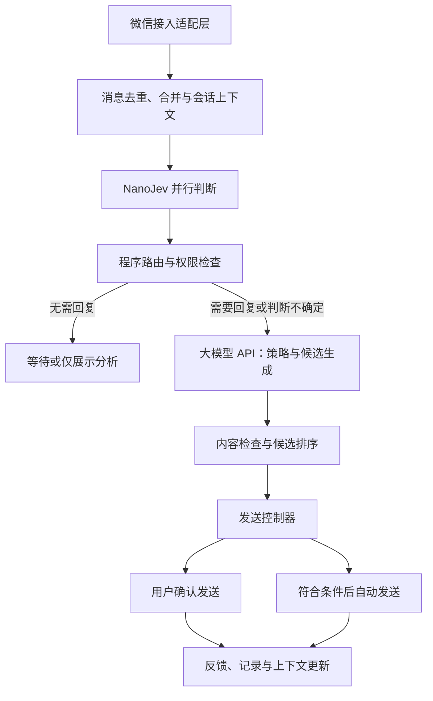

# 微信 AI 聊天助手开发计划

## 1. 目标与已确认事项

构建运行在 Windows 上的微信聊天助手，采用大小模型协同方案：NanoJev 分析聊天中的情绪、意图等信号，大模型 API 结合上下文进行回复决策并生成候选内容，后续支持受控的自动聊天。

已确认：

- 首先部署到 Windows 端。
- 小模型使用 [TianyuCodings/NanoJev](https://github.com/TianyuCodings/NanoJev)。
- 大模型通过 API 调用，具体供应商和模型待确定。
- 先完成规划，再按阶段验证和实施。

当前规划假设：以个人微信、中文文字私聊为第一版场景，使用本地侧栏或悬浮窗提供辅助能力。个人微信接入方式及实际兼容性尚未验证。

本文为开发计划，不表示任何功能已经实现或通过测试。用户提供的截图作为功能与展示参考，其中的模型判断和百分比不作为真实标签或性能依据。

## 2. 第一版范围

第一版闭环：指定联系人消息 → 情绪意图分析 → 三条候选回复 → 用户选择或修改 → 确认发送。

包含：

- 中文文字私聊。
- 指定联系人启用或关闭助手。
- 情绪、意图、回复需求、紧急程度和风险信号展示。
- 结合上下文生成不同回应方式的候选回复。
- 用户编辑、确认发送和反馈记录。
- 暂停助手、异常提示和处理记录。

后续扩展：受控自动回复、群聊、图片和语音理解、移动端支持。第一版不默认接管全部联系人，也不默认开启自动发送。

## 3. 必须先验证的前提

### 3.1 NanoJev 的聊天判断能力

截至 2026-09-28 查阅的官方仓库，NanoJev 是基于 Qwen3-0.6B 的并行决策模型，支持 Choice、Boolean、Score 等判断输出；当前主要公开权重与评测面向游戏任务。因此，结构上支持情绪意图判断，并不代表现有权重已经具备可靠的中文聊天能力。

先评测现有权重，再根据结果决定是否进行聊天领域微调。未经领域评测和校准的概率不能直接视为准确率，也不能直接作为自动发送门槛。

### 3.2 Windows 微信接入

需要区分“用户在微信里与 AI 聊天”和“AI 代替用户回复已有好友会话”。微信客服等渠道具备自身接入路径，不能据此推断能够接管个人微信好友会话。

接入验证覆盖：

- 当前微信版本下的消息读取方式与兼容性。
- 会话、联系人和消息身份的可靠识别。
- 收到的消息与本人发出消息的区分。
- 文本发送、发送结果核实和断线恢复。
- 切换窗口、未读消息、重复事件和消息撤回等情况。

优先核实可用接口及其权限范围；如评估桌面自动化，应实测其稳定性和限制。接入技术尚未选定，不承诺能够后台读取或发送所有会话。接入验证期间使用手动粘贴聊天记录，独立推进模型闭环。

## 4. 系统架构

| 模块 | 职责 | 边界 |
| --- | --- | --- |
| Windows 客户端 | 展示分析、候选、联系人配置和模式开关 | 不直接决定自动发送权限 |
| 微信适配层 | 读取消息、定位会话、发送文本、核实结果 | 与模型服务解耦，可替换实现 |
| 本地业务服务 | 会话状态、消息队列、路由和任务取消 | 按会话串行处理，防止上下文串线 |
| NanoJev 服务 | 输出结构化判断、分布和不确定性 | 不生成最终聊天内容，不独立授权发送 |
| 大模型 API 适配器 | 回复策略、候选生成和必要的歧义复核 | 供应商可替换，返回结构化结果 |
| 发送控制器 | 权限、消息版本、限流和发送状态检查 | 实际发送由代码规则控制 |
| 本地存储 | 配置、会话摘要、候选和反馈 | 联系人及会话数据隔离 |

大模型必须接收必要的聊天原文和上下文。NanoJev 的标签是辅助证据，不能替代事实、指代、反讽和关系背景。

## 5. NanoJev 判断设计

将复杂理解拆成定义清楚、可并行执行的小问题。

| 维度 | 建议输出 | 设计要求 |
| --- | --- | --- |
| 情绪 | 难过、焦虑、生气、开心等 | 允许多个情绪共存 |
| 主要意图 | 倾诉、提问、请求帮助、邀约、确认、拒绝、结束话题、其他 | 主要意图使用互斥选项，次要意图可另行判断 |
| 回复需求 | 是否明确要求答复、是否适合继续接话 | 不将需要回应等同于允许自动发送 |
| 紧急程度 | 普通、较急、立即关注、信息不足 | 结合上下文判断 |
| 风险信号 | 人身安全、钱款、隐私、重要承诺等 | 分别判断，保留未知状态 |
| 上下文充分性 | 是否缺少前文、存在歧义或需要澄清 | 不确定时允许弃权或升级处理 |

底层保存分布及模型、题目模板版本，界面展示简短摘要。多标签情绪的独立分数不要求加总为 100%；互斥 Choice 分布与独立 Boolean 分数需要区分。

示例：“我受伤了”可能指身体受伤，也可能指情感表达。应结合前文，缺少信息时生成澄清候选，不能仅凭倾诉标签自动套用安慰话术。

截图中“风险：无 2%”一类表达应重新定义：明确显示的是“存在风险的分数”还是“无风险类别的分数”，避免误读。未经校准时注明为模型判断分数。

## 6. 大模型决策与候选生成

### 输入

- 最近若干轮对话、引用消息和必要的历史摘要。
- NanoJev 的结构化分析及不确定性。
- 联系人关系、用户确认的表达偏好和已确认事实。
- 当前工作模式、允许动作及不得代做的承诺。
- 当前会话消息版本，用于识别过期结果。

### 输出

- 动作建议：回复、等待、澄清或交给用户。
- 回复策略：共情、直接回答、补充询问、提供帮助或自然结束。
- 通常 2～3 条候选回复，体现不同回应方式。
- 候选依赖的假设、需要确认的事实及限制。

候选应有实际差异，例如“简短关心”“温和追问”“提供帮助”，而不是同一句话的同义改写。不能虚构用户的经历、日程、承诺或关系事实。

第一版尽量通过一次 API 调用完成策略与候选生成，设置超时、费用预算和响应结构校验。API 失败或响应无法解析时停止本轮自动发送。

NanoJev 可在评测证明有效后参与候选排序，但不作为唯一内容审核者。

## 7. 工作模式与自动发送控制

| 模式 | 行为 | 开放阶段 |
| --- | --- | --- |
| 分析模式 | 只展示分析 | 模型评测及早期验证 |
| 辅助回复 | 生成候选，用户选择或编辑后确认发送 | 第一版主功能 |
| 自动回复 | 指定联系人、时段和场景内自动发送 | 影子运行通过后逐步开放 |

自动模式的规则由程序执行：

1. 按联系人显式启用，配置时段、范围和连续回复上限。
2. 对钱款、重要承诺、明显歧义及关键风险信号退回人工处理。
3. 合并对方连续消息，避免每收到一句就抢答。
4. 用户手动回复或接管时，取消该会话尚未发送的任务。
5. 发送前重新核对会话身份和消息版本；收到新消息后使旧候选失效并重新处理。
6. 提供短暂的可取消待发送窗口，以及全局暂停按钮。
7. 发送结果不确定时先核实，不盲目重试。
8. 模型超时、上下文缺失、权限异常或接入不稳定时停止自动发送。

建议任务状态：待分析 → 待生成 → 待审核 → 待确认或待自动发送 → 发送中 → 已发送、已取消或结果待核实。

对不支持服务端幂等的接入方式，不能仅凭本地记录承诺严格一次发送；需要发送前去重、发送后核实，并保留人工处理路径。

## 8. 技术与数据方案

以下为初步选型，待接入及推理验证后固定版本：

- Python 本地业务服务，负责流程编排与 API 适配。
- NanoJev 独立推理进程，常驻加载模型并批量处理判断请求。
- Windows 侧栏或悬浮窗，具体 UI 框架待确定。
- SQLite 保存配置、会话摘要、处理状态和反馈。
- 可替换的大模型 API 适配层。
- CPU/GPU 部署路径待实测，当前显卡和显存信息尚未确认。

主要数据对象包括：会话、消息、分析结果、回复候选、发送任务、联系人策略和用户反馈。消息与候选必须关联会话标识和上下文版本。

聊天记录默认在本地保存，按任务向云端发送必要上下文；提供保留期限和删除能力。API 密钥使用系统凭据存储或受保护配置，不写入代码与日志。联系人记忆应区分用户确认事实和模型推断，模型推断不自动变成事实。

聊天内容、引用和导入文档始终作为待分析数据，不允许其中的指令改变系统权限、读取其他会话或触发未授权发送。

## 9. 实施阶段及验收

| 阶段 | 交付物 | 验收重点 |
| --- | --- | --- |
| P0：可行性验证 | Windows 微信接入实验、NanoJev 初始聊天评测、硬件性能记录 | 能否可靠识别会话并收发消息；当前权重是否适用 |
| P1：离线闭环 | 粘贴聊天记录后输出分析和候选 | 上下文理解、候选差异、事实一致性和结构化响应稳定性 |
| P2：微信辅助模式 | 侧栏、联系人配置、候选编辑和确认发送 | 会话对应正确；重复消息不重复处理；发送结果可核实 |
| P3：影子运行 | 记录系统本来会自动发送的内容，实际不自动发送 | 自动策略误判、候选过期、人工接管原因和调用成本 |
| P4：限定自动回复 | 白名单、取消窗口、暂停、发送记录与恢复 | 新消息竞态、人工接管、重复发送防护及异常降级 |

P0 若发现聊天判断能力不足，应先做领域训练或调整判断题设计；若微信接入受阻，继续推进离线和辅助输入闭环，不将未验证的自动接入描述为已完成。

自动回复上线前，应根据影子运行结果约定可接受的错误边界、覆盖率和人工接管率，不能仅凭某个未经校准的置信度阈值开放。

## 10. 评测与双模型收益验证

先收集 200～500 段经授权、脱敏的中文对话用于初始评测，覆盖倾诉、反讽、拒绝、邀约、歧义短句和连续消息。该规模用于发现明显问题，不代表正式可靠性认证。

如需微调：

- 按完整会话隔离训练、校准和测试数据，避免同一会话泄漏到不同集合。
- 大模型可辅助标注，关键与歧义样本人工复核。
- 单独校准各判断维度，评估弃权机制和分布外输入。
- 固定模型、数据、题目模板和评测版本，便于复现。

对比两条基线：仅用大模型判断和生成；NanoJev 路由加大模型生成。

| 类别 | 关注指标 |
| --- | --- |
| 判断质量 | 各标签精确率与召回率、关键风险漏判、不确定性与校准表现 |
| 回复质量 | 候选采纳率、编辑程度、事实错误和表达偏好匹配 |
| 自动化可靠性 | 错会话发送、重复发送、过期候选发送、取消成功与人工接管 |
| 性能 | 小模型推理耗时、端到端延迟、内存与显存占用 |
| 成本 | 每轮 API 调用数、输入输出量、调用费用和本地推理开销 |

只有在回复质量可接受的前提下，双模型方案降低成本、延迟或改善控制能力，才证明协同有价值。如果每条消息仍调用大模型，加入小模型本身不会自动降低成本。

## 11. 待确认事项与下一步

待确认：

- Windows 版本、微信版本及个人微信接入目标。
- 本机 CPU、内存、显卡和显存。
- 大模型 API 供应商、预算和可用网络环境。
- 可用于评测的授权聊天样本。
- 首批联系人场景及希望模仿的表达风格。

下一步先执行 P0，优先验证 NanoJev 中文聊天判断质量及 Windows 微信可靠接入。通过后推进离线闭环、辅助回复，再逐步开放受控自动聊天。

## 12. 参考资料

- [NanoJev 官方仓库](https://github.com/TianyuCodings/NanoJev)：模型结构、公开权重、推理方式及评测范围。
- [NanoJev 输入契约](https://github.com/TianyuCodings/NanoJev/blob/main/docs/TYPESAFE_CONTRACT.md)：实现适配时核实输入与输出约定。
- [腾讯云微信客服文档](https://cloud.tencent.com/document/product/269/117050)：微信客服渠道的接入说明；不作为个人好友会话接管能力的依据。

资料查阅日期：2026-09-28。具体接入能力、依赖版本与模型版本以实施时核验结果为准。
